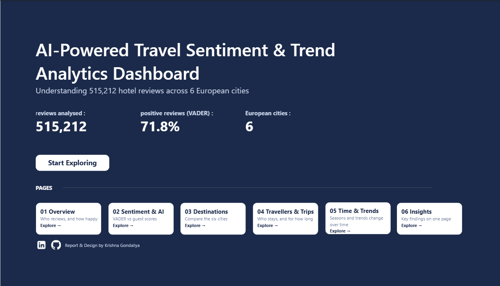
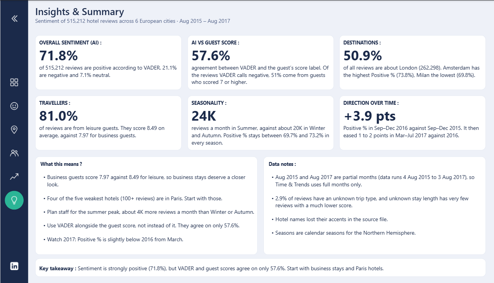

# AI-Powered Travel Sentiment and Trend Analytics Platform

An end-to-end analytics project that measures guest sentiment in 515,212 European hotel reviews using VADER and a machine learning model, and presents the results in a 7-page Power BI dashboard and a live Streamlit app.

**[Live app](https://travel-sentiment-analytics-fcapeck7aedpsakimdss4q.streamlit.app/)** · **[Power BI file (.pbix)](https://drive.google.com/file/d/1sLpDbXpanIikK5XZpEz9b9R4nVCDZgzp/view?usp=sharing)**

 

## Problem Statement

Hotels collect thousands of guest reviews but struggle to see what guests feel across cities, trip types, nationalities and seasons. This project turns raw, unstructured review text into measurable sentiment and trend insights that a hotel manager or analyst can act on.

## Objectives

1. Clean and prepare a large-scale hotel review dataset.
2. Apply NLP preprocessing to the review text.
3. Measure the sentiment of every review with VADER.
4. Compare VADER's labels with the guests' own score labels.
5. Train a machine learning classifier to predict sentiment.
6. Identify destination, traveller, seasonal and time-based trends.
7. Present the findings in a Power BI dashboard and an interactive Streamlit app.

## Dataset

Source: [515K Hotel Reviews Data in Europe (Kaggle)](https://www.kaggle.com/datasets/jiashenliu/515k-hotel-reviews-data-in-europe)

| Stage | Rows | Columns |
|---|---|---|
| Original dataset | 515,738 | 17 |
| After data cleaning | 515,212 | 17 |
| After NLP preprocessing | 515,212 | 19 |

- 1,492 hotels in 6 European cities
- 227 reviewer nationalities
- Reviews from August 2015 to August 2017

The raw and intermediate CSV files are not included in this repository because of their size.

## Pipeline

```
Raw dataset → Cleaning → NLP preprocessing → Exploratory analysis
→ VADER sentiment analysis → Trend analysis → Machine learning model
→ Power BI dashboard → Streamlit app
```

1. **Data collection:** loaded and inspected the Kaggle dataset.
2. **Data cleaning:** removed duplicates, handled missing values, converted dates and numeric fields, built a combined review text column and cleaned it (lowercase, URLs, HTML tags, punctuation, extra whitespace).
3. **NLP preprocessing:** tokenisation, stopword removal (keeping negations such as *no*, *not*, *never*) and lemmatisation.
4. **Exploratory analysis:** hotels, cities, nationalities, scores, dates and trip types.
5. **Sentiment analysis:** VADER compound score on every review (positive ≥ 0.05, negative ≤ -0.05).
6. **Trend analysis:** yearly, monthly and seasonal review activity.
7. **Machine learning:** TF-IDF features with Logistic Regression, trained on guest-score labels (notebook 07).
8. **Dashboard and app:** Power BI dashboard and Streamlit application.

## Key Results

### Sentiment (VADER)

| Sentiment | Reviews | Share |
|---|---|---|
| Positive | 369,929 | 71.80% |
| Neutral | 36,630 | 7.11% |
| Negative | 108,653 | 21.09% |

### VADER vs the machine learning model

Both are measured against the guest's own score label (7+ Positive, 5 to 6.9 Neutral, below 5 Negative).

| Method | Result |
|---|---|
| VADER agreement with guest-score label | 57.6% (all 515,212 reviews) |
| Baseline: always predict "Positive" | 65.1% |
| ML model (TF-IDF + Logistic Regression) | 73.5% accuracy (103,041 unseen test reviews) |

The ML model beats the baseline by about 8 points, but it is weaker on Neutral (F1 0.45) and Negative (recall 0.47) reviews because most guest scores are Positive. VADER is not trained on the target, so its lower score does not mean it is useless: it measures the words, while the baseline ignores the text.

### Other findings

- Trip type: 81.0% Leisure, 16.1% Business, 2.9% Unknown.
- 70.0% of reviews come from repeat guests.
- Leisure guests score higher than business guests (8.49 vs 7.97).
- The UK supplies 47.6% of reviews, and the top 5 countries supply 63.5%.
- Review activity peaked in August 2016, with 27,252 reviews.

## Power BI Dashboard

The dashboard was built from business questions to KPIs to visuals, and has 7 pages: Cover, Overview, Sentiment & AI, Destinations, Travellers & Trips, Time & Trends and Insights. Screenshots of every page are in `travel_app/assets/dashboard/`.



Interactive file: [Download the .pbix](https://drive.google.com/file/d/1sLpDbXpanIikK5XZpEz9b9R4nVCDZgzp/view?usp=sharing). Google Drive cannot preview `.pbix` files, so download it and open it in Power BI Desktop (Windows only). In Desktop, Ctrl + click the sentiment chips.

## Streamlit App

The [live app](https://travel-sentiment-analytics-fcapeck7aedpsakimdss4q.streamlit.app/) has six pages, including the dashboard screenshots, a data explorer, and **Try the AI**, where you can paste a hotel review and get its predicted sentiment. Free Streamlit apps sleep when unused, so the first load may take about a minute.

## Project Structure

```
travel-sentiment-analytics/
│
├── notebooks/            # 01 to 07: collection, cleaning, preprocessing,
│                         # EDA, sentiment, trends, machine learning
├── models/
│   └── sentiment_model.joblib
├── travel_app/
│   ├── app.py
│   ├── make_summary.py
│   ├── summary.csv
│   ├── requirements.txt
│   └── assets/dashboard/ # Power BI screenshots
├── .streamlit/
├── README.md
└── requirements.txt
```

## Run Locally

1. Clone the repository:
```
   git clone https://github.com/Krishnaaa0811/travel-sentiment-analytics.git
   cd travel-sentiment-analytics
```
2. Install the dependencies:
```
   pip install -r travel_app/requirements.txt
```
3. Start the app:
```
   python -m streamlit run travel_app/app.py
```

`travel_app/summary.csv` is already included. To rebuild it, download the dataset from Kaggle, place the analysis-ready file locally and run `python travel_app/make_summary.py`.

## Limitations

- VADER is a general-purpose dictionary and can misread hotel wording and mixed reviews.
- Neutral reviews are only about 7% of the data, so the ML model is weakest on them.
- The ML model predicts the score-based label, not true emotion.
- August 2017 is a partial month (the latest review is 3 August 2017), so its count is low.
- 2.9% of reviews have an unknown trip type, and the long tail of nationalities has very few reviews each.
- Some accented hotel names were already lost in the source data.

## Future Work

- A hotel-specific sentiment lexicon.
- A stronger model, such as a transformer.
- A live review data feed.

## Technologies

Python, Pandas, NumPy, NLTK, VADER, scikit-learn, Jupyter Notebook, Power BI, Streamlit, Git and GitHub.

## Author

**Krishna Gondaliya**
B.E. Information Technology, Gyanmanjari Innovative University, Bhavnagar (graduating June 2027)
[LinkedIn](https://www.linkedin.com/in/gondaliyakrishna) · [GitHub](https://github.com/Krishnaaa0811)